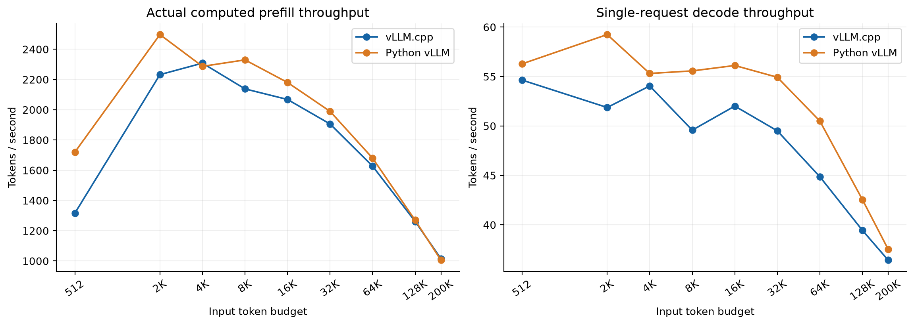
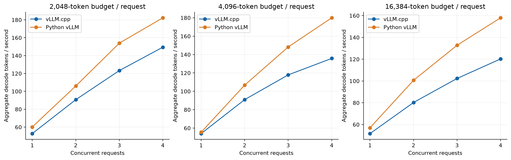
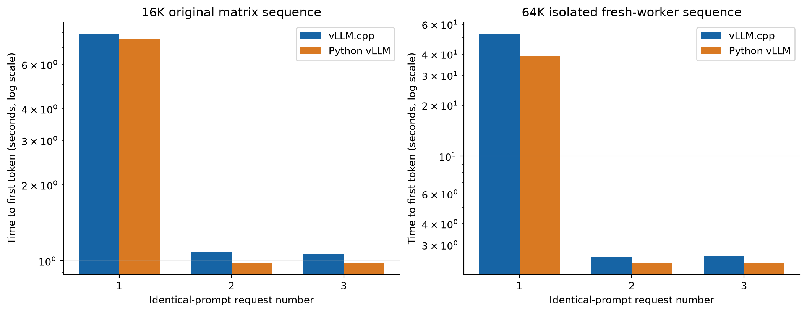
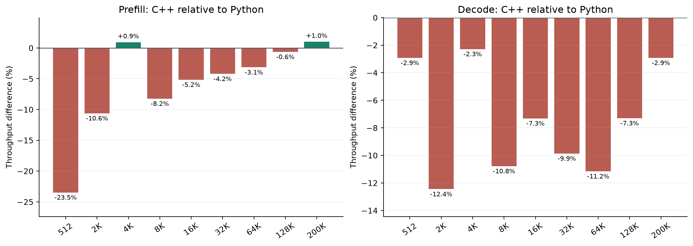

# B70 auto/2 serving comparison, 2026-10-20

The reviewed candidate enables request-stable automatic recurrent-prefix
alignment and retains bounded long-Q1 mode 2. A prompt fitting the resolved
nominal scheduling capacity keeps its normal prefill geometry. Longer eligible
prompts may split at the existing safe recurrent-state checkpoint. Classification
uses the original prompt length, including under concurrent admission.

`VT_RECURRENT_PREFIX_ALIGN` accepts unset/`auto`, `force`/`1`, or `off`/`0`.
`off` disables the additional forced split; natural cache hits remain possible.
`VT_XPU_XE2_LONG_DECODE` retains explicit `0`/`1` rollback modes; default `2`
extends the guarded B1/Q1 path to at most 128 physical pages. Unsupported
layouts fall back. This does not accelerate arbitrary batches or verification.

## Fresh comparison

[Download the standalone English HTML report](index.html). It embeds all four
charts and works offline. [JSON](comparison.json) and [CSV](comparison.csv)
retain the numerical tables. The original report and chart bytes are unchanged.

Both engines use matched model, precision and sampling settings on one Intel
Arc Pro B70: pinned Qwen3.8-27B EXL3 4.00 bpw, FP16 activations, FP32 GDN
state, FP8 KV, MTP3, temperature 1, top-p 0.95, top-k 20, original seeds,
thinking disabled and ignore_eos=true. Scheduling and library policies differ.
Each engine completed 20 scenarios, 70 measured waves and 124 requests, plus
three isolated 64K prefix requests. All 254 measured requests matched the frozen
original inputs, reached 1,024 output tokens and reported zero preemptions.

C1 decode reaches 87.6–97.7% of Python throughput over the measured budgets.
C4 aggregate reaches 75.5–82.0%. Aggregate rates pool tokens and elapsed time
in fully overlapping decode windows; they are not per-request rates times four.
Throughput deltas are not equal-sized latency overheads. The approximately
200K point has one observation; exact lengths, repeats and ranges are in the
report. Host cgroup peaks are not GPU memory; a full-matrix GPU allocator peak
was not collected.

C1 actual-computed prefill and decode under the matched settings above. Budgets
are workload labels, not exact prompt lengths. Five repeats through 32K, three
at 64K/128K, and one at approximately 200K. The native configuration is auto/2.

C1–C4 observed workload points at 2K/4K/16K budgets. C2–C4 each have three
waves. Aggregate rates use full-overlap generation counters. Points use their
original separate requests; these are not identical-response scaling curves.

Original 16K ordering and a separate fresh-worker 64K sequence, three identical
requests per engine. Cache counters establish cold/warm status. The matrix's
first 64K prefix request already had 14,400 cached tokens; the isolated sequence
starts at zero. Native TTFT falls from 7.92 to about 1.07 seconds at 16K and
52.65 to about 2.57 seconds in the isolated 64K sequence. Python's isolated
64K cold TTFT is 38.74 seconds; this differs from the regular 64K sweep.

Relative throughput is `100 * (C++ / Python - 1)`, under the C1 conditions above.
A 20% deficit corresponds to 25% more time for an equal amount of work.

## Focused qualification and accepted limits

The targeted scheduler checks pass 4 cases / 1,324,952 assertions. Existing long
page-policy checks pass 4 / 197; graph-policy checks pass 2 / 40. These are the
recorded focused checks against the unchanged measured sources, not a new full
suite. All 74 intended code/test files match the reviewed source manifest,
including all 31 previously untracked files. No product bytes changed during
PR integration.

Three neighboring 4K auto/2 versus off/2 pairs retain matching output hashes
and MTP counts: median decode -0.12%, TTFT +0.17%. Two additional fixed seeds
also match. The historical approximately 11.4% short-prompt loss is recovered
in these registered cases.

The developer accepts these documented tradeoffs for this intermediate
milestone following the supplied Pro review:

- Native 16K/C4 auto/2 versus off/1: median decode -2.55%, TTFT +5.02%.
  This comparison changes both alignment and long-decode settings. It differs
  from the -23.9% C4 throughput delta against Python.
- A short 4,091-token resend loses forced warm hits under auto: warm TTFT is
  1.77 seconds versus 1.13 with force; auto has lower cold TTFT, 1.76 versus
  1.93 seconds. This is one diagnostic sequence, not an automatic policy rule.
- The fresh 64K/MTP0/C2 mixed prefill/decode diagnostic completed 27 advancing
  steps but did not finish within 480 seconds plus a 15-second stop. Its raw
  FAIL / exit 137 remains. Same-input restored C2 replay is bit-exact within
  its tested state/logit/KV scope; it does not prove cold mixed-case liveness.
- The known Python-module response lacks its required closing code fence.
  Recovered inner code passes 32/32 functional checks; strict format fails.
- Current byte-copy checks cover the original 16K/64K C1 MTP0/3 cases and a
  scoped C2 replay. They do not prove direct draft-KV or universal numerical,
  semantic, long-output or image-workload parity.

The full native/Python matrix is complete. Existing image qualification retains
its earlier source pins and scope; this fresh comparison is text-only.

## Identity and evidence

Measured executable SHA-256:
`b85a7911ac9602a70986f74fcd0f5af41fbebed1074e534c83f65c05911157f0`.

[Source manifest](source-manifest.json) records all 74 pending product/test file
hashes and their original base commit. It distinguishes 43 tracked changes
from 31 new files. The latest four-file auto-policy correction is part of a
larger preserved optimization candidate, not the source of every change.

The portable comparison records immutable image/model/executable identities
and hashes of the original detailed comparison and Pro-review evidence archive.
Full raw requests, SSE outputs, counter samples, focused test receipts and failed
diagnostics remain in that separately supplied archive. The external Pro review
checked the supplied evidence offline; it did not run new GPU tests.
