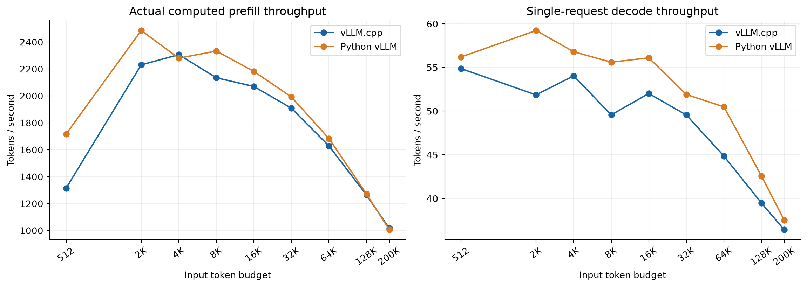
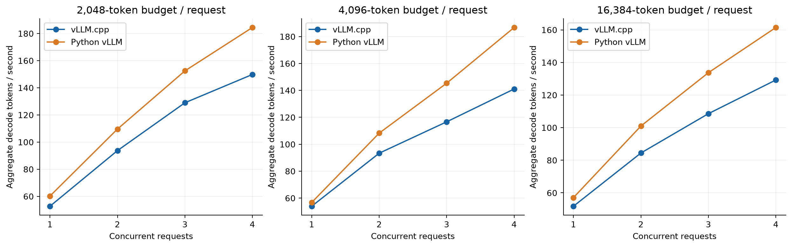
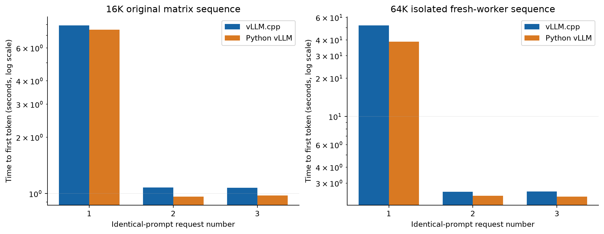
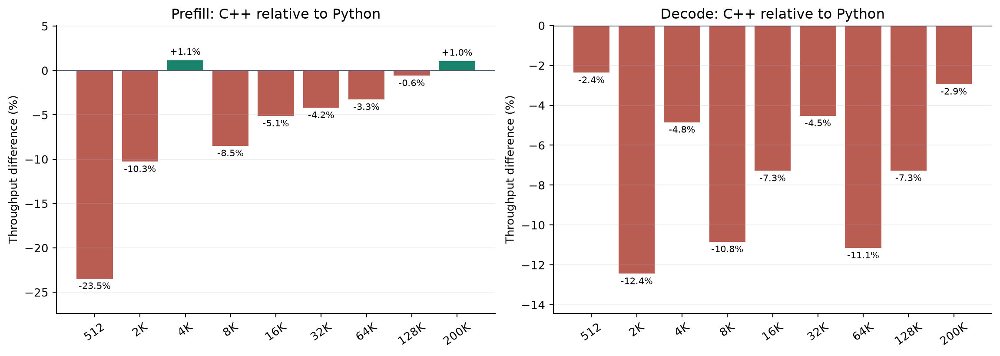

# B70 batched-Q1 serving comparison, 2026-10-21

The promoted route adds exact B2–B4 one-query-per-request attention to the bounded
Xe2 donor. Offsets must be `[0,1,...,B]`; all prior hardware, dtype, scale, layout,
causal, page and fresh-metadata guards remain. The fixed16-MiB scratch owner is
verified and batch offsets are checked. B1, Q4, ragged, mixed and unsupported
packets retain their routes. `VT_XPU_XE2_BATCHED_Q1` defaults to1; explicit0 is
rollback. Request-stable auto alignment / long-Q1 mode2 remain the baseline.
Expanded SiLU2 and mixed-prefill1 remain experimental; defaults stay SiLU1 and
mixed-prefill0. All five policy overrides were unset in the fresh native workers.

## Fresh native / Python comparison

[Open the standalone English HTML report](index.html). All four charts are
embedded for offline use; [JSON](comparison.json) and [CSV](comparison.csv)
retain the numerical tables. [Pro-plan disposition](PRO_PLAN_DISPOSITION_EN.md)
separates work packages0–4 and their remaining limits.

Both engines ran the unchanged original 20-scenario recipe on one Intel Arc Pro
B70, sequentially:70 measured waves/124 requests and three additional isolated64K
prefix requests per engine. All 254 original prompt/payload checks passed; every
response reached 1,024 tokens with length finish, zero preemptions, unchanged
computed/cache accounting and valid full-overlap concurrency windows. Model:
Qwen3.8-27B EXL3 4.00bpw revision `113cf7ab958054860e43fb7f3063b1af19171095`, FP16 activations,
FP32 GDN state, FP8 KV, MTP3, temperature1/top-p0.95/top-k20, original seeds,
ignore_eos=true, thinking off and no logprobs. CPU/host memory are uncapped;
scheduler/graph/library policies differ and are recorded in the full report.

C1 post-first-token decode reaches 87.6–97.6% of Python throughput.
The approximately200K point has one observation. The C4 comparison is:

| Input budget / request | C++ aggregate tok/s | Python aggregate tok/s | C++ relative throughput |
| --- | ---: | ---: | ---: |
| 2,048 | 149.81 | 184.43 | -18.8% |
| 4,096 | 141.05 | 186.74 | -24.5% |
| 16,384 | 129.26 | 161.46 | -19.9% |

C1 uses post-first-token counts / server-reported request decode seconds. C2–C4
pool token counters and time over fully overlapping decode windows; aggregate
is not per-request throughput times concurrency. Relative throughput is
100×(C++/Python−1), not an equal-sized latency overhead. Client TTFT/E2E, observed
ranges, acceptance, computed prefill and cold/warm cache work remain separate.

Actual-computed prefill and C1 decode for the original budgets. Exact observed
prompt lengths, repeat counts and ranges are in the report. Input budgets are
workload labels; the approximately200K point is a single observation.

Observed C1–C4 workload points at2K/4K/16K budgets, three waves per C2–C4 point.
Concurrent values pool full-overlap counters/windows. Original tasks differ
between points, so these are not identical-response scaling curves.

Original16K ordering and a separate fresh-worker64K sequence. All three original
resends per engine retain actual hit/work counts, which establish cold/warm
status. The matrix-internal64K sequence is retained separately in raw data;
its cache history must not be substituted for the isolated sequence.

Relative throughput100×(C++/Python−1); a20% throughput deficit means25% more time
for an equal token count. Percentage signs do not express duration overhead.

## Focused evidence and retained limits

The full comparison uses a disclosed offline final committed-prefill plateau rule
for every engine/window, followed by unchanged strict counter checks. One native
C4-4K window lost its leading final-prefill sample:141.018→140.186 tok/s; the other
69 native matrix windows are unchanged. Raw samples, original driver fields,
requests and receipts remain intact; no rerun or performance-dependent cutoff.
[Analysis records](counter-window-analysis.json) and the detecting replay source
are included. TTFT/E2E, C1 request-duration decode and work/cache counts are
unaffected. The activity plateau uses native live computed tokens and Python
live prompt tokens, which its pinned source publishes on first prefill output.
Python actual-computed histograms publish at request completion and remain the
independent prefill-throughput metric. Neither cache work nor actual computed
throughput is inferred from the live activity counter. Source/hash evidence is
in [publication metadata](prefill-counter-publication.json). This is a
post-capture correction, not a preregistered window rule.

The paired Q1 screen used one frozen executable for explicit0/1, six alternating
C4 A/B pairs, two A/A controls and one C1 sentinel. At 16K, all three gains
(+6.074/+6.603/+6.925%) exceed both observed A/A differences; median TTFT+0.013%
and E2E−2.654%. The 4K median+2.777% trend is below observed A/A variation and
not independently noise-qualified. Observed A/A pairs are not confidence bounds.
Complete attention-call time fell82.5–88.3%; this is not whole-model speedup.

Promoted-default focused checks pass GPU 4 cases/1880 assertions, policy 1 / 36,
graph 3 / 250. Coverage includes full NaN scratch, poisoned neighboring pages,
short one-split launches, capacity/overflow fallback, live metadata, aliases,
B4→3→2→1, actual cancellation/replacement and cross-queue/graph lifetime.
The actual43-step lifecycle finishes six requests with matching retained greedy
sequences and cancels one without resurrection. No full test suite was run.

Existing auto/2 cold/C4 costs and lost short forced-prefix hits remain accepted
baseline tradeoffs. The strict Python-module closing-fence failure remains,
despite 32/32 recovered-code checks. The earlier default64K MTP0/C2 raw FAIL/partial
is preserved; only experimental mixed-prefill1 completed its separate new
bounded case (101.980s,64 steps, positions 65,500/65,500). This MTP3 performance
matrix does not freshly qualify default MTP0/C2 liveness or universal semantics.
Current bytes/ownership, allowed numerical variation and quality are separate
claims. No new image matrix is claimed. Host cgroup peak is not VRAM; full-matrix
GPU allocator peak was not collected. Snapshot batching was skipped because
at most one owner published per step; force remains an explicit deployment
choice for short repeated prefixes.

## Identity

Product revision `5fcad5dcab817a7462b5c884243c9b168d4b2843`; executable SHA-256
`c87739a6986b13de1240213ba0ed12075cea05b007ec6cc79c754e5042ed9f07`.

[Source manifest](source-manifest.json) binds 78 committed source/test paths by
exact content to the measured build. The build began at the recorded previous
commit plus working delta; it is not claimed to be a clean-HEAD build. The
same-binary paired screen and promoted-default build have separate identities;
only the default literal changed in production after scoring. Additional
NaN/short/default detecting checks were test-only. Raw requests, SSE responses,
metrics, manifests, failures and focused receipts are in the separate review
archive. Earlier image/baseline evidence keeps its original pins and scope.
